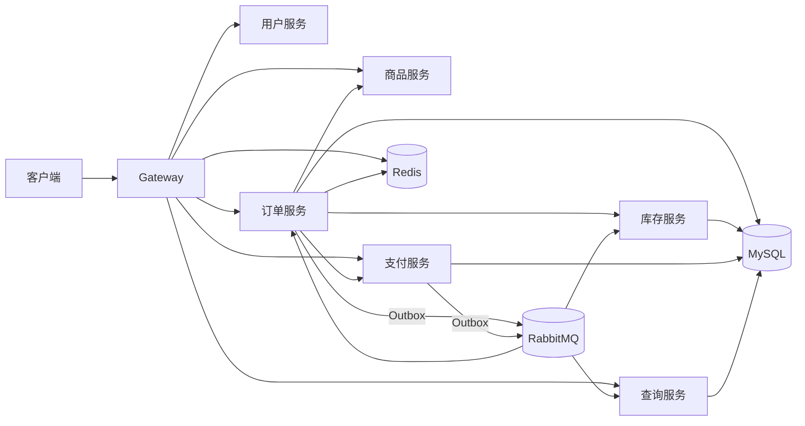

# Java 订单支付系统

基于 Java 17 和 Spring Cloud 构建的订单支付系统，覆盖商品结算、订单创建、库存预占、支付确认、超时关单、发货和收货。项目围绕订单状态、库存数量和支付结果的一致性，实现本地事务、Outbox 消息、消费幂等、失败补偿、分库分表和查询投影，并提供本机运行与故障验证记录。

支付服务内置演示支付渠道，可通过接口触发支付成功通知，验证支付单、订单、库存和查询投影之间的完整处理链路。

## 已实现功能

| 领域 | 功能 |
|---|---|
| 订单 | 商品重新报价、创建幂等、订单状态机、取消、支付、发货、收货及用户订单查询 |
| 库存 | MySQL 条件更新预占库存，预占确认与释放，库存流水、过期释放及失败补偿 |
| 支付 | 支付单创建与查询、演示支付成功通知、通知去重及支付事件发布 |
| 消息一致性 | 业务数据与 Outbox 同事务提交，发布确认、失败退避重试、消费日志与业务状态幂等 |
| 超时与恢复 | RabbitMQ TTL + DLX 延迟关单、数据库扫描兜底、消费有限重试与死信队列、支付/关单异常记录 |
| 服务治理 | Nacos 服务注册发现与配置接入、客户端负载均衡、Gateway Redis 限流、Sentinel 限流与慢调用/异常熔断 |
| 分库分表 | ShardingSphere-JDBC 两库八表、订单绑定表、订单号路由、Redis 路由缓存及数据库回源 |
| 查询与观测 | MySQL CQRS 投影、事件版本处理、投影重建、TraceId、Actuator、Prometheus、Grafana 及业务告警 |

另提供 Redis Lua 库存预扣入口、k6 订单创建压测脚本，以及覆盖库存补偿、消息恢复、重复消费、支付与关单竞争的故障开关和验收记录。

## 架构与交易流程



主链路：重新报价 → MySQL 预占库存 → 本地事务写入订单、明细、状态日志与 Outbox → 创建支付单 → 处理支付成功通知 → 发布支付事件 → 推进订单状态 → 确认库存 → 更新查询投影。

订单状态流转：

```text
WAIT_PAY → WAIT_DELIVERY → WAIT_RECEIVE → COMPLETED
    └──→ CANCELED
```

金额以分为单位保存为 `BIGINT`。库存保持 `total_stock = available_stock + reserved_stock + sold_stock`；预占使用 `available_stock >= quantity` 条件更新，确认和释放按预占状态处理。支付成功和关单通过订单状态与版本条件更新裁决并发竞争。

业务服务在本地事务中写入业务表与 Outbox，发布器独立投递 RabbitMQ 并处理确认与重试。消费者在事务中记录消费标识并更新业务状态。支付成功晚于订单关闭时，系统记录 `PAY_SUCCESS_AFTER_ORDER_CLOSED` 对账异常。

RabbitMQ 保留已有持久队列的声明兼容性。支付死信进入 `payment.succeeded.dlq`，库存确认和释放共用 `inventory.dlq`，查询投影与关单分别使用 `query.projection.dlq`、`order.close.dlq`。

## 技术栈与服务

Java 17、Spring Boot 3.5.7、Spring Cloud 2025.0.0、Spring Cloud Alibaba 2025.0.0.0、ShardingSphere-JDBC 5.5.2、MySQL、Redis、RabbitMQ、Nacos、Sentinel、Prometheus、Grafana。

工程包含 20 个 Maven reactor 模块，运行时由网关与 6 个业务服务组成：

| 服务 | 本机端口 | 职责 |
|---|---:|---|
| `order-gateway` | 8080 | API 路由、认证、TraceId、限流 |
| `order-user-service` | 8081 | 演示账号登录、JWT、当前用户 |
| `order-product-service` | 8082 | 商品、SKU、价格和商品快照 |
| `order-inventory-service` | 8083 | 库存预占、确认、释放和补偿 |
| `order-order-service` | 8084 | 订单编排、状态机、Outbox、超时关闭 |
| `order-payment-service` | 8085 | 支付单、演示支付通知和支付事件 |
| `order-query-service` | 8086 | CQRS 查询投影及重建 |

## 本机启动

以下步骤采用“Docker Compose 运行中间件，宿主机运行 Java 服务”的方式。准备 JDK 17、Maven 3.9+、Git 和 Docker Compose。

### 1. 获取代码并准备中间件配置

```bash
git clone https://github.com/djyking/java-order-payment-system.git
cd java-order-payment-system
```

将 `docker/.env.example` 复制为 `docker/.env`，填写以下值：

- `NACOS_AUTH_TOKEN`：至少 32 字节随机值的 Base64 编码。
- `NACOS_AUTH_IDENTITY_KEY`、`NACOS_AUTH_IDENTITY_VALUE`：独立的节点身份值。
- `SENTINEL_JAR_PATH`：本机 Sentinel Dashboard 1.8.9 JAR 的绝对路径。可从 [Sentinel 1.8.9 发布页](https://github.com/alibaba/Sentinel/releases/tag/1.8.9)获取 `sentinel-dashboard-1.8.9.jar`；Windows 路径使用正斜杠，例如 `D:/middleware/sentinel-dashboard-1.8.9.jar`。

Compose 将该 JAR 挂载到 Sentinel 容器，并读取 `.env` 中的配置。

```bash
docker compose --env-file docker/.env -f docker/docker-compose.yml up -d
docker compose --env-file docker/.env -f docker/docker-compose.yml ps
```

等待中间件健康检查通过。MySQL 首次使用空数据卷时，会按文件名顺序自动执行 `sql/` 中的全部初始化脚本，创建业务库、分片库、查询投影字段、演示商品、压测商品及 10 万笔分片验收订单。已有数据卷按下文执行升级脚本。

| 中间件 | 宿主机入口 |
|---|---|
| MySQL | `localhost:13306` |
| Redis | `localhost:16379` |
| RabbitMQ AMQP / 管理界面 | `localhost:25672` / `http://localhost:25673` |
| Nacos 服务端 / 控制台 | `localhost:18848` / `http://localhost:18849` |
| Nacos gRPC | `localhost:19848` |
| Sentinel Dashboard | `http://localhost:18858` |
| Prometheus | `http://localhost:19090` |
| Grafana | `http://localhost:13000` |

本机示例数据库账号与 RabbitMQ 账号均为 `order/order123456`，Grafana 为 `admin/admin123456`。Java 服务的默认连接地址与上述端口一致，可通过 `MYSQL_HOST`、`MYSQL_PORT`、`MYSQL_USER`、`MYSQL_PASSWORD`、`REDIS_HOST`、`REDIS_PORT`、`RABBITMQ_HOST`、`RABBITMQ_PORT`、`RABBITMQ_USER`、`RABBITMQ_PASSWORD`、`NACOS_SERVER_ADDR` 和 `SENTINEL_DASHBOARD` 覆盖。

本机运行直接使用各服务的 `application.yml`。服务同时配置了 Nacos 可选配置导入；如将 `config/nacos/` 示例发布到 Nacos，请按当前服务的运行位置填写中间件地址。

### 2. 升级已有数据库

首次使用空数据卷可直接进入下一步。沿用旧版数据库时，先停止 Java 服务写入并完成数据库备份，保留 MySQL 运行。在仓库根目录打开容器内的 MySQL 客户端：

```bash
docker compose --env-file docker/.env -f docker/docker-compose.yml exec mysql mysql -uroot -p
```

输入本机 MySQL root 密码后，依次执行：

```sql
SOURCE /docker-entrypoint-initdb.d/08_sharding.sql;
SOURCE /docker-entrypoint-initdb.d/11_query_projection_upgrade.sql;
```

两个脚本可重复执行，分别补齐分片结构与历史表字段、CQRS 查询投影字段。执行完成后，再构建并启动 Java 服务。Compose 保留原项目标识，以继续使用已有持久数据卷。

### 3. 构建并启动 Java 服务

在仓库根目录执行：

```bash
mvn clean package
```

该命令构建全部模块、执行测试并生成可执行 JAR。随后在独立终端中分别启动以下服务，待业务服务注册后启动网关：

```bash
java -jar order-product-service/target/order-product-service-1.0.0-SNAPSHOT.jar
java -jar order-inventory-service/target/order-inventory-service-1.0.0-SNAPSHOT.jar
java -jar order-payment-service/target/order-payment-service-1.0.0-SNAPSHOT.jar
java -jar order-query-service/target/order-query-service-1.0.0-SNAPSHOT.jar
java -jar order-user-service/target/order-user-service-1.0.0-SNAPSHOT.jar
java -jar order-order-service/target/order-order-service-1.0.0-SNAPSHOT.jar
java -jar order-gateway/target/order-gateway-1.0.0-SNAPSHOT.jar
```

检查 `http://localhost:8080/actuator/health` 及 8081–8086 各服务的 `/actuator/health`。上述订单服务命令使用默认单库模式。

### 4. 启用订单分片模式

使用分片模式时，以以下命令替换上面的订单服务启动命令：

```bash
java -jar order-order-service/target/order-order-service-1.0.0-SNAPSHOT.jar --spring.profiles.active=sharding
```

分片规则为 `user_id % 2` 分库、`order_id % 8` 分表；订单、明细、状态日志使用绑定表，Outbox、消费日志、路由表与对账异常按 `user_id` 同库保存。`orderNo` 查询通过 Redis 和 `order_route` 解析路由；运营查询使用 CQRS 投影。

`application-sharding.yml` 默认连接 `localhost:13306` 下的 `order_trade_0`、`order_trade_1`，可通过 `SHARD_DB0_URL`、`SHARD_DB1_URL` 覆盖。首次 Compose 初始化或上述已有数据库升级步骤会建立分片结构。`sql/09_sharding_verification_data.sql` 提供 10 万笔容量验收数据；分布与查询记录见 [分片验收](docs/sharding-verification.md)。

## 订单与支付接口示例

演示登录账号为 `demo/demo123`。以下请求使用默认启用的本机开发 Header，入口统一为 Gateway。示例使用 Bash/curl；PowerShell 可调用 `curl.exe` 并按终端规则传递 JSON。

```bash
curl -X POST http://localhost:8080/api/orders/settlement -H 'Content-Type: application/json' -H 'X-User-Id: 10001' -d '{"items":[{"skuId":10001,"quantity":1}]}'

curl -X POST http://localhost:8080/api/orders -H 'Content-Type: application/json' -H 'X-User-Id: 10001' -H 'X-Idempotency-Token: order-demo-001' -d '{"items":[{"skuId":10001,"quantity":1}]}'
```

从创建结果取出 `orderNo`，替换下面的 `ORDER_NO`；从支付请求结果取出 `payOrderNo`，替换 `PAY_ORDER_NO`：

```bash
curl -X POST http://localhost:8080/api/orders/ORDER_NO/pay -H 'X-User-Id: 10001'

curl -X POST http://localhost:8080/api/payments/PAY_ORDER_NO/mock-success -H 'X-User-Id: 10001' -H 'X-Notify-Id: notify-demo-001'

curl http://localhost:8080/api/orders/ORDER_NO -H 'X-User-Id: 10001'
```

`mock-success` 是内置演示渠道的支付成功入口。同一通知标识重复提交按幂等逻辑处理；支付结果经 RabbitMQ 异步推进订单状态和库存确认。

## 测试与运行验证

```bash
mvn clean test
```

当前自动化测试共 10 个用例：订单状态机、H2 库存条件更新和通知标识去重 4 例，调用实际 CQRS 消费者 SQL 的事件乱序测试 4 例，以及 RabbitMQ 队列声明兼容性测试 2 例。

启动服务后，可安装 k6 并使用初始化的压测专用 SKU `19999` 执行订单创建压测：

```bash
k6 run -e RATE=10 -e DURATION=30s -e SKU_ID=19999 -e BASE_URL=http://localhost:8080 scripts/k6-order.js
```

历史本机验收覆盖服务启动、Nacos 负载分配、Sentinel 熔断恢复、分片路由、Outbox 恢复、重复消息处理、DLQ 重放、CQRS 重建及 k6 压测。各记录保留当时的日期、版本与环境；性能数据及测量口径见 [压测记录](docs/pressure-test-result.md)。

故障注入通过各服务的 `debug.failure` 配置控制，覆盖库存预占后失败、订单提交前失败、MQ 发布异常、库存慢调用或异常、支付创建异常和消费者异常。场景步骤、数据变化与恢复结果见 [故障验收记录](docs/failure-injection-result.md)。

## 可观测性与资料

HTTP 链路携带 `X-Trace-Id`，服务开放 `/actuator/health` 和 `/actuator/prometheus`。Compose 配置 Prometheus、Grafana 及 RabbitMQ 指标采集，覆盖 HTTP 请求、JVM、连接池、库存、支付、Outbox、队列、DLQ 与对账异常，并提供对应告警规则。

- [系统架构](docs/architecture.md) · [数据结构](docs/database.md) · [一致性设计](docs/consistency.md)
- [RabbitMQ 消息拓扑](docs/rabbitmq.md) · [关键设计说明](docs/interview-notes.md)
- [Nacos 验收](docs/nacos-verification.md) · [Sentinel 验收](docs/sentinel-verification.md)
- [分片验收](docs/sharding-verification.md) · [故障验收](docs/failure-injection-result.md) · [压测记录](docs/pressure-test-result.md)
